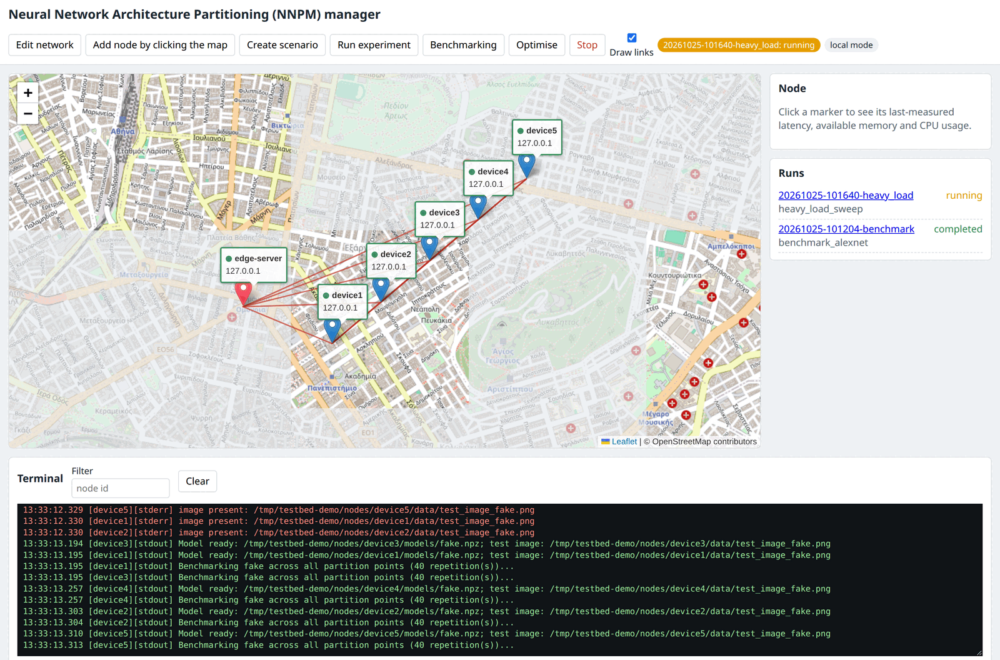
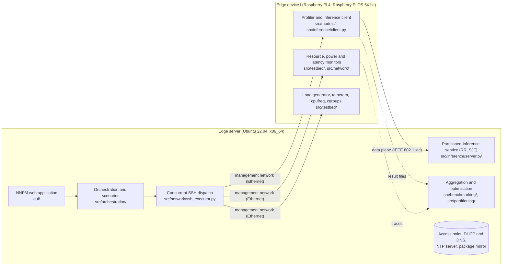

# Distributed Inference Testbed

**An experimental testbed for partitioned inference of deep neural networks and large language models across resource-constrained edge devices.**

[](https://github.com/Dimitrios-Kafetzis/Distributed-Inference-Testbed/actions/workflows/ci.yml)
[](https://github.com/Dimitrios-Kafetzis/Distributed-Inference-Testbed/releases)
[](https://www.python.org/downloads/release/python-3110/)
[](LICENSE)
[](https://docs.astral.sh/ruff/)
[](https://mypy-lang.org/)
[](CITATION.cff)

Five Raspberry Pi 4 boards on a dedicated IEEE 802.11ac wireless network, an edge server that hosts the access point, and a web application that drives every experiment end to end: scenario definition, concurrent Secure Shell (SSH) dispatch, layer-by-layer profiling under controlled compute and network conditions, measurement collection, and partition optimisation. Everything also runs on a single machine with no hardware at all.

The repository implements the testbed described in Chapter 3 ("Experimental Testbed Description") and Appendix B ("Testbed Implementation Details") of the PhD thesis *Dynamic Partitioning and Resource Orchestration for AI Model Deployment in Resource-Constrained Wireless Edge Networks* (Dimitrios Kafetzis, Athens University of Economics and Business, 2026). The thesis is the specification: every file, script and output name it cites is the name used here.



## Contents

- [Highlights](#highlights)
- [Architecture](#architecture)
- [Supported models](#supported-models)
- [Getting started](#getting-started)
- [Running experiments](#running-experiments)
- [Repository layout](#repository-layout)
- [Documentation](#documentation)
- [Quality assurance](#quality-assurance)
- [Requirements](#requirements)
- [Citing](#citing)
- [Provenance and related work](#provenance-and-related-work)
- [Contributing, security and licence](#contributing-security-and-licence)

## Highlights

- **Complete experiment pipeline.** One scenario file describes the model, the devices, the repetitions, the scheduling policy of the edge server, and per node the network conditions, the compute load and the hardware constraints. The pipeline applies it, profiles, collects, aggregates, optimises and tears everything down, in seven stages with a journal that undoes every change in reverse order, also on failure and after a restart.
- **Controlled conditions on real hardware.** Traffic-control network emulation (`tc-netem`: delay with constant, uniform or square-wave variation, jitter, loss, rate cap, per destination), background traffic with iperf3, a duty-cycle compute load generator with the light, moderate and heavy regimes of the thesis, and hardware heterogeneity through `cpufreq` caps, cgroups v2 memory limits and thread counts.
- **Fine-grained measurement.** Per-layer latency, memory and operation counts; per-phase timing of partitioned inference (local, transmission, queueing, remote); a 1 Hz resource monitor; INA260 power traces with energy and energy-delay product; ping latency and iperf3 throughput. All traces are aligned on an NTP-synchronised common origin.
- **Partition optimisation.** The analytical delay model of the thesis for Round-Robin (RR) and Shortest-Job-First (SJF) scheduling at the edge server, with greedy, exhaustive and trend-based search, and a plug-in interface for new algorithms.
- **The NNPM web application.** The Neural Network Architecture Partitioning (NNPM) manager: an interactive map of the topology with three-ping reachability probes every two seconds, click-to-add and draggable nodes, distance-derived link latencies, dialogs for scenario creation, benchmarking and optimisation, a live merged terminal, a results browser and a stop button that tears down cleanly.
- **Daemonless and reproducible.** Nothing stays resident on a device beyond the SSH server: every device-side process is started for the duration of an experiment and stopped at its end. Scenarios are versioned and replayable, random seeds are set on every node, dependencies are hash-pinned per role and platform, and provisioning installs from a versioned local package mirror with a verifiable manifest.
- **Runs without hardware.** A local mode simulates every node on one machine with a fake model, dry-run shaping and a fake `/sys` tree. The whole pipeline, the web application and the provisioning scripts are exercised this way in continuous integration.
- **Extensible.** Any `tf.keras.applications` classifier and any Hugging Face decoder of a known family (GPT-2, Llama, Mistral, Qwen2, Gemma) run through generic adapters with automatic cut points; model parameters, input sources (files, image folders with labels, prompts) and a partition-equivalence check are scenario fields; a model catalogue with checksums holds the weights. See [docs/adding_a_model.md](docs/adding_a_model.md).
- **Runtime plug-ins.** An inference runtime is a plug-in with a scenario block, readiness checks, maintenance actions and a results parser, all driven from NNPM. The author's [HeadSplit](https://github.com/Dimitrios-Kafetzis/headsplit) runtime for head-level partitioning of decoder-only LLMs is the first: installed from the mirror at a pinned commit, prepared (profile, checkpoint) and run from the web application under the testbed's shaping, load, monitors and metadata. See [docs/adding_a_runtime.md](docs/adding_a_runtime.md).

## Architecture



The testbed has three layers. The **NNPM manager** (web application and orchestration package) runs each experiment from start to finish. The **measurement infrastructure** runs on the devices only while an experiment is in progress: profiler, inference client, resource and power monitors, latency and throughput tools. The **system runtime** is the operating system and the frameworks installed by provisioning from a local mirror. Management traffic (SSH, result collection, NTP, packages) uses a wired network; inference traffic, latency measurement and shaping use the wireless data plane, so the two never interfere. The full description, stage by stage, is in [docs/architecture.md](docs/architecture.md).

## Supported models

| Model | Framework | Granularity | Used in |
|---|---|---|---|
| AlexNet | TensorFlow | 11 stages (the partition points of Chapter 4) | Chapter 4 |
| VGG-16, ResNet-50 | TensorFlow | Keras layers and blocks | Chapter 4 |
| GRU QoE predictor | TensorFlow | recurrent layers | Chapter 4 |
| MobileNetV2, EfficientNet-B0, DenseNet-121, any `tf.keras.applications` model | TensorFlow | single-tensor cuts of the functional graph, found automatically and thinned to stages of comparable work | extensions |
| GPT-2 | PyTorch | decoder layers; per-head, projection and feed-forward timing through forward hooks | Chapter 5 |
| TinyLlama-1.1B | PyTorch | decoder layers; head-wise decomposition | Chapters 5 and 6 |
| Llama 3.2 1B, Qwen2.5 0.5B, any Hugging Face decoder of the GPT-2, Llama, Mistral, Qwen2 or Gemma family | PyTorch | decoder layers; head-wise decomposition from the family table | extensions |
| TinyLlama-1.1B on HeadSplit | PyTorch RPC (external runtime) | heads across devices with inter-layer speculation | Chapter 6 |
| `fake` | none | configurable synthetic stages, for tests and local mode | |

New models are registered through `src/models/registry.py` ([docs/adding_a_model.md](docs/adding_a_model.md)); new partitioning algorithms through `src/partitioning/algorithms/`; new runtimes through `src/orchestration/runtimes/` ([docs/adding_a_runtime.md](docs/adding_a_runtime.md)). Weights live in a model catalogue with checksums (`examples/models.yaml`, `python -m src.models.weights`).

## Getting started

### Without hardware (five minutes)

```bash
git clone https://github.com/Dimitrios-Kafetzis/Distributed-Inference-Testbed.git
cd Distributed-Inference-Testbed
uv venv .venv --python 3.11
uv pip install --python .venv/bin/python --require-hashes -r requirements/dev.lock

# The fast test suite: fakes, dry runs and local mode.
.venv/bin/pytest -m "not slow"

# A whole experiment on simulated nodes, with shaping and load in dry-run mode.
.venv/bin/python -m src.orchestration.experiment run \
    --scenario examples/scenarios/local_demo.yaml --local
ls .local_testbed/results/latest/

# The NNPM web application with simulated nodes, at http://127.0.0.1:8001/
.venv/bin/python -m gui.app --local --devices 5
```

Without `uv`: `python3.11 -m venv .venv && .venv/bin/pip install --require-hashes -r requirements/dev.lock`.

### On the hardware

1. **Assemble** the testbed as in the [setup guide](docs/setup_guide.md): five Raspberry Pi 4 boards on an open rack, an edge server with a USB IEEE 802.11ac adapter for the isolated access point, and an Ethernet switch for the management network. The bill of materials is in the guide.
2. **Edge server.** Copy `config.example.yaml` to `config.yaml` and `nodes.example.json` to `nodes.json`, edit them, then run `scripts/provision/provision_edge_server.sh --allow-upstream` followed by `scripts/provision/build_mirror.sh wheels`. This configures the access point, DHCP and DNS, the NTP server, the package mirror and the NNPM service.
3. **Devices.** Flash Raspberry Pi OS Bookworm 64-bit, run `scripts/provision/prepare_image.sh <node id> <boot partition>`, boot the board on the switch, then run `scripts/provision/provision_device.sh <node id>` (after `build_mirror.sh apt <node id>` once). Every device is installed from the mirror only.
4. **Check.** Open `http://<edge server management address>:8001/`; every marker should be green within a few seconds. Run `scripts/base_station/run_full_benchmarking.sh examples/scenarios/baseline.yaml` and find the three output files in `results/latest/`.
5. **Validate.** Work through the [hardware validation checklist](docs/hardware_validation_checklist.md): the physical checks that the test suite cannot perform, each with its expected outcome.

Every provisioning script accepts `--dry-run` and prints the commands it would run.

## Running experiments

A scenario is one YAML or JSON object. The example below profiles AlexNet on four devices under different compute loads, runs partitioned inference at five partition points, and sweeps the scheduling policy of the edge server:

```yaml
name: ch4_validation
model: alexnet
devices: [device1, device2, device3, device4]
repetitions: 5
seed: 2024
edge_server: {policy: SJF, nominal_frequency: true, profile_capacity: true}
inference: {enabled: true, partition_points: [0, 2, 4, 8, 11], repetitions: 50}
load:
  device2: {mode: processes, processes: 1}
  device3: {mode: processes, processes: 2}
  device4: {mode: processes, processes: 3}
optimisation: {enabled: true, algorithm: greedy, objective: total_delay}
sweep: {path: edge_server.policy, values: [RR, SJF]}
```

Run it from NNPM (Create scenario, then Save and run) or from the command line:

```bash
scripts/base_station/run_experiment.sh examples/scenarios/ch4_validation.yaml
scripts/base_station/run_full_benchmarking.sh examples/scenarios/baseline.yaml   # profiling only, no load or shaping
scripts/base_station/clean_devices.sh                                            # undo a run interrupted by a crash
cd results/latest && ../../.venv/bin/python -m src.partitioning.delay_optimizer \
    calculated_max_partition_points.json total_averages_of_benchmark_results.json \
    final_latencies_averages.json --scheduling_algorithm SJF --mode optimize     # optimise a finished run again
```

Every run writes one directory under `results/`, with the scenario version, the run metadata (software versions, hardware facts and NTP status of every node, recorded before any change), the journal, the merged log, the raw records and traces, and the three aggregated outputs the thesis names: `total_averages_of_benchmark_results.json`, `calculated_max_partition_points.json` and `final_latencies_averages.json`. The [scenario reference](docs/scenario_reference.md) lists every field with its default; the [results format](docs/results_format.md) describes every file. Example scenarios for the Chapter 4 validation and the Chapter 6 heterogeneity and round-trip-time studies are in [examples/scenarios/](examples/scenarios/).

## Repository layout

| Path | Content |
|---|---|
| [`src/common/`](src/common/) | infrastructure used everywhere: injectable command runners, clocks and `/sys` access, tagged detached processes, run directories and the run journal, seeds, the coordinated start signal, run metadata |
| [`src/network/`](src/network/) | SSH transport and concurrent dispatch, result collection, latency, throughput and power measurement |
| [`src/testbed/`](src/testbed/) | device-side control: load generator, tc-netem shaping, background traffic, heterogeneity, resource monitor, edge-server frequency policy |
| [`src/models/`](src/models/) | model adapters (TensorFlow and PyTorch, generic Keras-applications and Hugging Face decoder adapters), analytical operation counts, the per-layer profiler, the device-side inference entry point with the partition check, input sources, the model catalogue |
| [`src/inference/`](src/inference/) | the partitioned-inference service of the edge server (RR and SJF), its wire protocol and the device client |
| [`src/benchmarking/`](src/benchmarking/) | measurement records and schema, aggregation over repetitions, trace merging, partition feasibility |
| [`src/partitioning/`](src/partitioning/) | the delay model, the search algorithms and `delay_optimizer.py` |
| [`src/orchestration/`](src/orchestration/) | scenarios (schema, versions, sweeps), the experiment pipeline, local mode, the map rule, the runtime plug-ins (testbed, HeadSplit) |
| [`src/provisioning/`](src/provisioning/) | template rendering and the mirror manifest used by the provisioning scripts |
| [`gui/`](gui/) | the NNPM web application: Flask blueprints, the page, vendored Leaflet |
| [`scripts/`](scripts/) | `base_station/` (run and clean), `end_device/` (profiling, transfer, shaping), `provision/` (image, edge server, devices, mirror) |
| [`docs/`](docs/) | documentation and JSON Schemas |
| [`examples/scenarios/`](examples/scenarios/) | example scenarios, including the Chapter 4 and Chapter 6 procedures |
| [`data/sample/`](data/sample/) | synthetic sample output files, labelled as such |
| [`requirements/`](requirements/) | direct dependencies and hash-pinned lock files per role and platform |
| [`tests/`](tests/) | the pytest suite, with local-mode integration tests and golden files |

## Documentation

The documentation is published as a website at **https://dimitrios-kafetzis.github.io/Distributed-Inference-Testbed/** (built from `docs/` with MkDocs on every push) and lives in the repository:

| Document | Content |
|---|---|
| [NNPM tutorial](docs/nnpm_tutorial.md) | a guided tour of every function of the web application, with screenshots taken in local mode |
| [Architecture](docs/architecture.md) | the three layers, an experiment stage by stage, daemonless operation, local mode |
| [Installation](docs/installation.md) | installing from the lock files on the edge server, the devices and a development machine; the version table |
| [Setup guide](docs/setup_guide.md) | hardware and bill of materials, physical layout, networks and addressing, operating systems, access point, NTP, power sensors, mirror, provisioning order |
| [NNPM user guide](docs/nnpm_user_guide.md) | the web application: map, probes, topology editing, dialogs, sweeps, run summary page, Runtimes dialog, terminal, local mode, HTTP interface |
| [Scenario reference](docs/scenario_reference.md) | every scenario field with its default |
| [Results format](docs/results_format.md) | the run directory and every record format |
| [Module reference](docs/module_reference.md) | every module and script with its command line |
| [HeadSplit integration](docs/headsplit_integration.md) | the optional external LLM runtime: configuration, preparation from NNPM, what a run does |
| [Adding a model](docs/adding_a_model.md), [Adding a runtime](docs/adding_a_runtime.md) | how the testbed is extended: adapters, parameters, weights and inputs; the runtime plug-in interface |
| [Hardware validation checklist](docs/hardware_validation_checklist.md) | what to verify on the physical testbed, with expected values |
| [Provisioning](scripts/provision/README.md), [Dependencies](requirements/README.md), [Sample data](data/sample/README.md) | the provisioning scripts, the lock files, the synthetic samples |

## Quality assurance

| Check | Scope |
|---|---|
| `pytest -m "not slow"` | 330 tests: unit tests with fake runners, transports, clocks and `/sys`; golden-file tests of the provisioning command plans; local-mode integration tests of the whole pipeline, the web application and the HeadSplit runtime against stub scripts |
| `pytest -m slow` | 15 tests that build and run the real TensorFlow and PyTorch models on the CPU (the thesis models, the Keras applications, every decoder family) |
| `ruff check`, `ruff format --check` | formatting and lint |
| `mypy --strict` | `src/` and `gui/` |
| `shellcheck -x` | every shell script |
| `tests/test_thesis_names.py` | every path, symbol and output name the thesis cites exists |
| `tests/test_no_hardcoded_literals.py` | no addresses or home directories in code |
| `tests/test_docs_links.py` | every relative link in the documentation resolves |

The [continuous-integration workflow](.github/workflows/ci.yml) runs all of the above on every push and pull request, plus the local-mode quick start and a dry run of the provisioning scripts. Tests marked `hardware` need the physical testbed and never run in continuous integration.

## Requirements

| Component | Minimum supported | Pinned in the lock files (thesis, Appendix B, Table B.1) |
|---|---|---|
| Edge devices | Raspberry Pi 4 Model B, Raspberry Pi OS 64-bit | Bookworm 64-bit, Python 3.11 |
| Edge server | Ubuntu 22.04 LTS, x86_64 | Ubuntu 22.04 LTS, Python 3.11 |
| Python | 3.11 | 3.11 |
| TensorFlow | 2.8.0 (CPU) | 2.15.1 |
| PyTorch, Transformers | 2.1.2 (CPU), 4.36 | 2.1.2, 4.46.3 |
| Flask, Paramiko | 2.2.0, 2.11 (edge server only) | 3.1.3, 5.1.0 |
| Time synchronisation | NTP server on the edge server, clients on the devices | chrony, configured by provisioning |

The complete table and the installation commands per role are in [docs/installation.md](docs/installation.md).

## Citing

If you use this testbed in your research, please cite the thesis and the software. Citation metadata in Citation File Format is in [CITATION.cff](CITATION.cff); GitHub renders it under "Cite this repository".

```bibtex
@phdthesis{kafetzis2026thesis,
  author = {Kafetzis, Dimitrios},
  title  = {Dynamic Partitioning and Resource Orchestration for {AI} Model Deployment
            in Resource-Constrained Wireless Edge Networks},
  school = {Athens University of Economics and Business},
  year   = {2026}
}

@inproceedings{kafetzis2024demo,
  author    = {Kafetzis, Dimitrios and Koutsopoulos, Iordanis},
  title     = {Demo: An Experimental Platform for {AI} Model Partitioning on Resource-constrained Devices},
  booktitle = {Proceedings of the 25th International Symposium on Theory, Algorithmic Foundations,
               and Protocol Design for Mobile Networks and Mobile Computing (ACM MobiHoc)},
  year      = {2024},
  pages     = {375--376}
}
```

## Provenance and related work

This repository continues the author's earlier [DNN-Partitioning-and-Offloading-Testbed](https://github.com/Dimitrios-Kafetzis/DNN-Partitioning-and-Offloading-Testbed), first presented as a demonstration at ACM MobiHoc 2024. The code was rewritten so that it implements the testbed exactly as the thesis describes it; the earlier repository remains available as reference material. [HeadSplit](https://github.com/Dimitrios-Kafetzis/headsplit), the author's runtime for head-level LLM partitioning with inter-layer speculation (Chapter 6), is integrated as an optional external component.

## Contributing, security and licence

Contributions are welcome: see [CONTRIBUTING.md](CONTRIBUTING.md) for the development set-up, the checks that must pass and the conventions of the code base. To report a vulnerability, follow [SECURITY.md](SECURITY.md). Changes between releases are listed in [CHANGELOG.md](CHANGELOG.md).

The software is released under the MIT Licence, see [LICENSE](LICENSE). Vendored third-party software and the map data shown in the screenshot are credited in [THIRD_PARTY_NOTICES.md](THIRD_PARTY_NOTICES.md).
