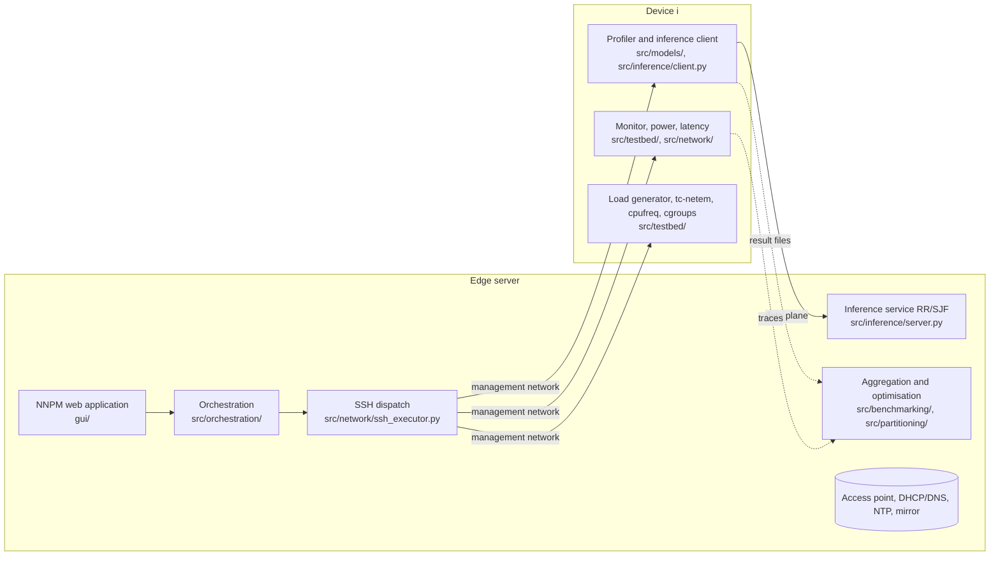

# Architecture

This document describes how the testbed software is organised and how an experiment flows through it. It follows Chapter 3 ("Experimental Testbed Description") and Appendix B of the thesis; where a name appears in the thesis (a file, a script, an output file), the code uses the same name.

## Three layers

1. **The Neural Network Architecture Partitioning (NNPM) manager** runs each experiment from start to finish: scenario configuration, concurrent Secure Shell (SSH) execution across the devices, profiling, collection and partition optimisation. It is a web application served from the edge server (`gui/`) on top of the orchestration package (`src/orchestration/`), which the command-line scripts in `scripts/base_station/` use as well.
2. **The measurement infrastructure** runs on the devices for the duration of an experiment: the per-layer profiler (`src/models/profiler.py`), the per-phase timing client of partitioned inference (`src/inference/client.py`), the resource-monitoring agent (`src/testbed/resource_monitor.py`), the power monitor (`src/network/power_measurement.py`), the latency and throughput measurements (`src/network/`), and, on the edge server, the aggregation pipeline (`src/benchmarking/`) that produces the inputs of the analytical models.
3. **The system runtime** is pre-existing software installed on every node: Raspberry Pi OS (64-bit) with Python 3.11, TensorFlow and PyTorch on the devices; Ubuntu with the same Python and frameworks on the edge server. Provisioning (`scripts/provision/`) installs and configures it from a local package mirror.

The edge server talks to the devices over the wired management network (SSH, result collection, NTP, package mirror); the devices talk to the edge server's inference service over the wireless data plane, which is also where latency is measured and shaping is applied. `nodes.json` holds both addresses of every node; `src/common/nodes.py` chooses the right one for each subsystem.

## Repository layout

| Path | Content |
|---|---|
| `config.example.yaml`, `nodes.example.json` | the two configuration files, copied to `config.yaml` and `nodes.json` at the repository root (`src/config.py`, `src/common/nodes.py`) |
| `src/common/` | infrastructure used everywhere: command runners (real, fake, dry run), clocks, rooted `/sys` access, tagged detached processes, run directories and the run journal, seeds, the coordinated start signal, run metadata, the device probe |
| `src/network/` | the transport and SSH dispatch layer, result collection, latency, throughput and power measurement, node statistics |
| `src/testbed/` | device-side control: load generator, tc-netem shaping, background traffic, heterogeneity (cpufreq, cgroups, threads), resource monitor, edge-server frequency policy |
| `src/models/` | model adapters (TensorFlow: AlexNet, VGG-16, ResNet-50, GRU predictor, any `tf.keras.applications` classifier with automatic cuts; PyTorch: GPT-2, TinyLlama, Llama 3.2 1B, Qwen2.5 0.5B, any Hugging Face decoder of a known family; a fake model), analytical operation counts, the profiler, the device-side inference entry point with the partition check, input sources, the model catalogue, head-wise LLM decomposition and hook-based profiling |
| `src/inference/` | the partitioned-inference service of the edge server (RR and SJF scheduling), its wire protocol and the device client with per-phase timing |
| `src/benchmarking/` | measurement records and their schema, aggregation over repetitions and trace merging, partition feasibility |
| `src/partitioning/` | the Chapter 4 delay model, the search algorithms (greedy, exhaustive, trend-based) and `delay_optimizer.py` |
| `src/orchestration/` | scenarios (schema, versions, sweeps), the experiment pipeline, local mode, the map rule, the runtime plug-ins (`runtimes/`: the testbed runtime and HeadSplit) |
| `src/provisioning/` | template rendering and the mirror manifest used by the provisioning scripts |
| `gui/` | the NNPM web application: Flask blueprints, the page, vendored Leaflet |
| `scripts/base_station/` | `run_full_benchmarking.sh`, `run_experiment.sh`, `clean_devices.sh` |
| `scripts/end_device/` | `train_and_run_benchmark.sh`, `transfer_files.sh`, `apply_latency.sh` |
| `scripts/provision/` | provisioning scripts and templates |
| `docs/` | this documentation and the JSON Schemas |
| `examples/scenarios/` | example scenarios, including the Chapter 4 and Chapter 6 procedures |
| `data/sample/` | synthetic sample output files (labelled as such) |
| `requirements/` | direct dependencies and hash-pinned lock files per role |
| `tests/` | pytest suite, including the local-mode integration tests and golden files |

## An experiment, stage by stage

A scenario (one JSON object, validated against `docs/schemas/scenario.schema.json`) names the model, the devices, the repetitions and seed, the edge-server policy, and, per node, the network conditions, the compute load and the heterogeneity settings. `src/orchestration/experiment.py` runs it in seven stages; every change a stage makes on a node is recorded in the run journal before the next step, so that the last stage can undo it.

| Stage | What happens | Where |
|---|---|---|
| preflight | the run directory is created; `metadata.json` records the scenario, the Git commit, the framework versions, the kernel version and the NTP status of every node, before any change; a node whose NTP offset exceeds `ntp_offset_threshold_ms` stops the run | `src/common/metadata.py`, `src/common/probe.py` |
| apply | edge-server frequency policy; per-node cpufreq cap, memory cgroup and thread count; tc-netem shaping (constant, uniform or square-wave delay, jitter, loss, rate cap); background traffic; load generators; monitoring agents and power monitors; then a settling time | `src/testbed/` |
| profile | a start instant T0 is chosen and passed to every device; each device waits for it, captures its time origin and profiles the model layer by layer (`train_and_run_benchmark.sh`); the edge server profiles its own capacity; optionally the devices run partitioned inference against the edge-server service and record the local, transmission and remote phases; with `checks.partition_equivalence` every device compares the partition points with the unpartitioned model; the stage belongs to the scenario's runtime, and an external runtime (`runtime: headsplit`) runs its own controller and workers instead | `src/models/`, `src/inference/`, `src/orchestration/runtimes/` |
| collect | latency and system-metric capture on every device; the result files are copied to the edge server with the device hostname prefixed to each name | `src/network/latency_measurement.py`, `scripts/end_device/transfer_files.sh`, `src/network/collection.py` |
| aggregate | `final_latencies_averages.json` (node statistics, also written into `nodes.json`), `total_averages_of_benchmark_results.json` (per-device averages over repetitions and the merged traces), `calculated_max_partition_points.json` (feasibility) | `src/network/node_statistics.py`, `src/benchmarking/` |
| optimise | the partition vector for the scenario's objective under the chosen scheduling policy, written next to the scenario version with the hashes of its inputs | `src/partitioning/delay_optimizer.py` |
| teardown | the journal entries are undone in reverse order (stop processes, clear shaping, restore frequencies, remove cgroups), then every remaining tagged process on each device is stopped; this runs on success, on failure and, through `teardown` or `clean_devices.sh`, after a restart | `src/common/runs.py`, `src/orchestration/experiment.py` |

The `benchmarking` pipeline (`run_full_benchmarking.sh`, the Benchmarking dialog) is the four-stage subset of Appendix B: dispatch, collection, post-processing and outputs; it applies no load and no shaping.

## Daemonless operation

Nothing of the testbed stays resident on a device. Each device-side process (monitor, load generator, latency injector, power monitor, inference client, HeadSplit worker) is started over SSH as a detached process in its own session and process group, carries a tag `testbed-<run id>-<component>` in its environment and as a `--tag` argument, and has its process-group id written to a PID file. Stopping a component kills its process group; `clean_devices.sh` finds survivors by tag. The only requirement on a device is the operating system with its SSH server and the inference runtime (`src/common/process_tags.py`).

## Measurement conventions

Intervals are integers in nanoseconds from `time.perf_counter_ns()`. Every record carries an origin, the NTP-synchronised wall clock and the monotonic counter captured together at the start signal, so traces from different devices can be aligned during aggregation. Memory is in mebibytes, CPU in percent, sizes in bytes. The record formats are described in [results_format.md](results_format.md).

## Local mode

Every component can run without hardware. In local mode (`--local`), each node becomes a working directory under one root; device-side commands run as local subprocesses, the privileged tools (`tc`, cpufreq, cgroups) run in dry-run mode or against a fake `/sys` tree, the inference service listens on the loopback interface and the `fake` model stands in for a real network. The continuous-integration workflow runs the whole pipeline this way, and NNPM can be demonstrated on a laptop with `nnpm --local`.

## Where to read next

- [installation.md](installation.md): installing the software on the edge server, the devices and a development machine.
- [setup_guide.md](setup_guide.md): hardware, networks, operating system, access point, NTP and provisioning.
- [nnpm_user_guide.md](nnpm_user_guide.md): the web application.
- [scenario_reference.md](scenario_reference.md): every scenario field.
- [results_format.md](results_format.md): the run directory and the record formats.
- [module_reference.md](module_reference.md): every module and its command line.
- [headsplit_integration.md](headsplit_integration.md): the optional HeadSplit runtime.
- [adding_a_model.md](adding_a_model.md) and [adding_a_runtime.md](adding_a_runtime.md): how the testbed is extended.
- [hardware_validation_checklist.md](hardware_validation_checklist.md): what must be checked on the physical testbed.
