# NNPM tutorial

A walk through every function of the Neural Network Architecture Partitioning (NNPM) manager, with screenshots. The screenshots were taken in **local mode**, where every node is simulated on one machine, so you can follow every step on a laptop without the testbed; on the hardware the same screens show the real devices. The [NNPM user guide](nnpm_user_guide.md) is the reference for each screen; this tutorial is the guided tour.

The screenshots are produced by `scripts/docs/nnpm_screenshots.py` (Playwright, `requirements/docs.in`), so they stay in step with the application.

## 1. Start NNPM

Without hardware:

```bash
uv venv .venv --python 3.11
uv pip install --python .venv/bin/python --require-hashes -r requirements/dev.lock
.venv/bin/python -m gui.app --local --devices 5
```

Open `http://127.0.0.1:8001/`. On the edge server, provisioning installs `nnpm.service`, so NNPM is already running at `http://<edge server management address>:8001/`; to start it by hand, run `.venv/bin/python -m gui.app` there. To require a login, set `nnpm_basic_auth_env` in `config.yaml` to the name of an environment variable holding `user:password`.

## 2. The main view

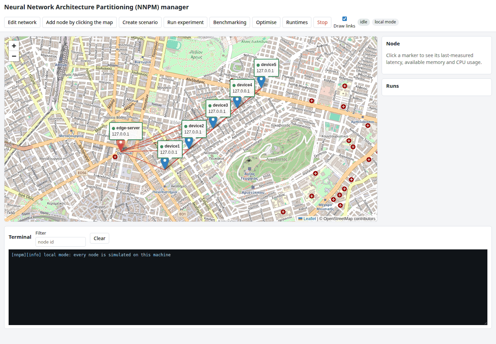

Three areas:

- **Toolbar**: Edit network, Add node by clicking the map, Create scenario, Run experiment, Benchmarking, Optimise, Runtimes, Stop; the "Draw links" box; the run indicator (`idle`, or the current run id with `running`); the `local mode` badge when every node is simulated.
- **Map**: one marker per node of `nodes.json`. The edge server (`Base Station` in the software) has a differently coloured marker. The label under a marker shows the node id, its data-plane address and a dot: green when the last reachability probe got three replies out of three pings, red otherwise, grey before the first probe. A probe round starts every two seconds. The red lines join every pair of nodes; hovering one shows the distance and the synthetic link latency (5 ms plus 1 ms per kilometre, clipped to 5 to 50 ms).
- **Side panel**: the Node panel (details of the clicked marker) and the Runs panel (the runs in the results directory, newest first).
- **Terminal** (below): the merged log of the running experiment, one line per device output, tagged `[node][stream]`; the Filter box keeps one node's lines; Clear empties the panel.

## 3. Nodes: inspect, edit, add

Click a marker. The Node panel shows the role, both addresses, the reachability and, after a benchmarking run, the last measured latency, available memory and CPU usage of the device, with the time and the run that produced them.

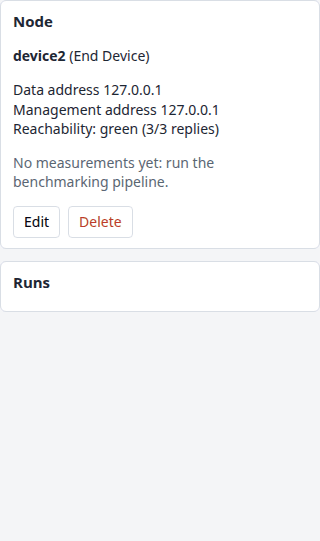

**Edit network** lists every node with Edit and Delete buttons and a form for a new node (id, role, data-plane address, management address, coordinates). Saving writes `nodes.json`, the single source of truth that the command-line scripts read too.

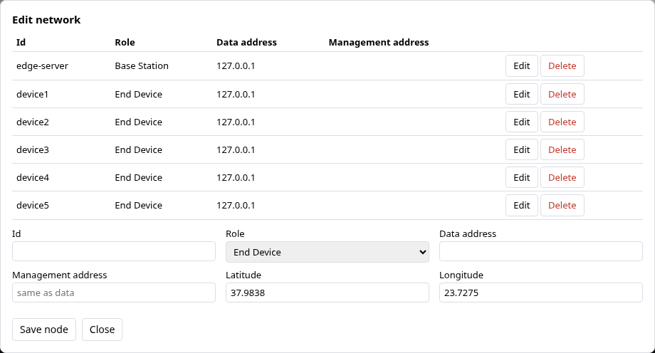

**Add node by clicking the map**: press the button (it stays highlighted), click the map where the device stands; the form opens with the clicked coordinates filled in. Enter the id and the addresses and save; the marker appears at once and the prober includes the node in its next round.

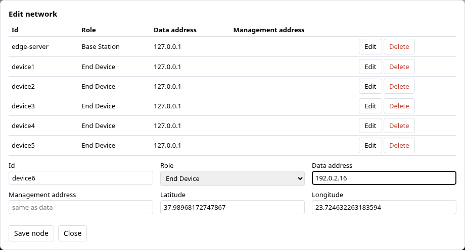

Markers are draggable: moving one saves the new coordinates, and the link latencies derived from the distances follow.

## 4. Create a scenario

A scenario holds every parameter of an experiment. The dialog saves it as a version (`scenarios/<name>/v<N>.json`) that can be run again later, identically.

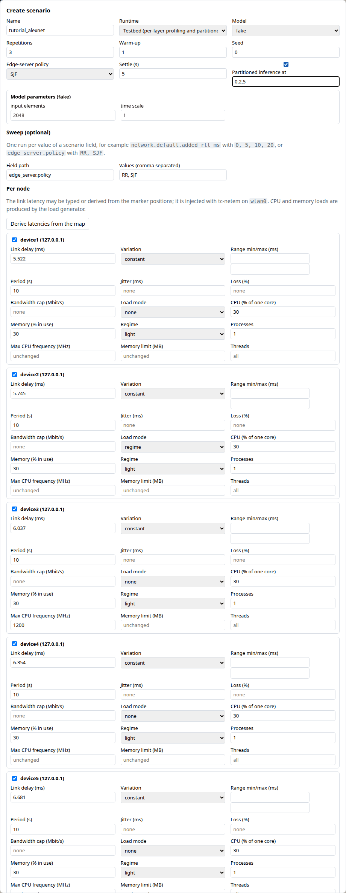

From top to bottom:

1. **Name, runtime, model.** The runtime is `testbed` by default (per-layer profiling and partitioned inference); an external runtime such as HeadSplit replaces the profile stage (section 9). The model list comes from the registry: the thesis models (`alexnet`, `vgg16`, `resnet50`, `gru_qoe`, `gpt2`, `tinyllama`), the generic adapters (`mobilenetv2`, `efficientnetb0`, `densenet121`, `keras_app`, `llama32_1b`, `qwen25_05b`, `hf_decoder`) and `fake` for local mode.
2. **Repetitions, warm-up, seed, edge-server policy (SJF or RR), settling time**, and the optional **partitioned inference** at a list of partition points.
3. **Model parameters**: shown when the chosen model declares some (here the fake model's input size and time scale; for a Keras model the number of classes, for a decoder the sequence length, for `keras_app` the application name, for `hf_decoder` the checkpoint). They are saved as `model_args`.
4. **Sweep**: a field path and comma-separated values make one run per value, run one after the other (`edge_server.policy` with `RR, SJF` in the screenshot; `network.default.added_rtt_ms` with `0, 5, 10, 20` is the Chapter 6 study).
5. **Per node**, one block per end device with a selection box: link delay (typed, or filled by **Derive latencies from the map**), variation (constant, uniform redraw, square wave) with its range and period, jitter, loss, bandwidth cap; load mode (none, fixed CPU and memory percentages, a regime of the thesis, backlogged processes); maximum CPU frequency, memory limit, threads. Shaping is applied with tc-netem on the device's data-plane interface at launch and removed at the end; the load generator runs for the whole run.

**Save scenario** stores the version; **Save and run** also starts it and shows the run id in the toolbar indicator.

## 5. Run an experiment and follow it

**Run experiment** picks a saved scenario version and starts it. **Benchmarking** is the shortcut for the four-stage profiling pipeline of Appendix B (model, repetitions, warm-up, seed; the devices whose last probe was green are preselected; no load or shaping):

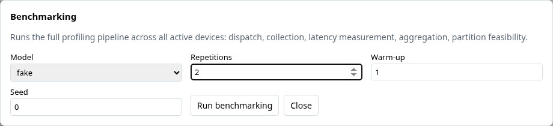

While a run is in progress the indicator turns orange, the Runs panel lists the run as `running`, and the terminal shows the devices' output as it arrives: the metadata probe, the per-node commands, the profiler's progress, the collection and the aggregation.

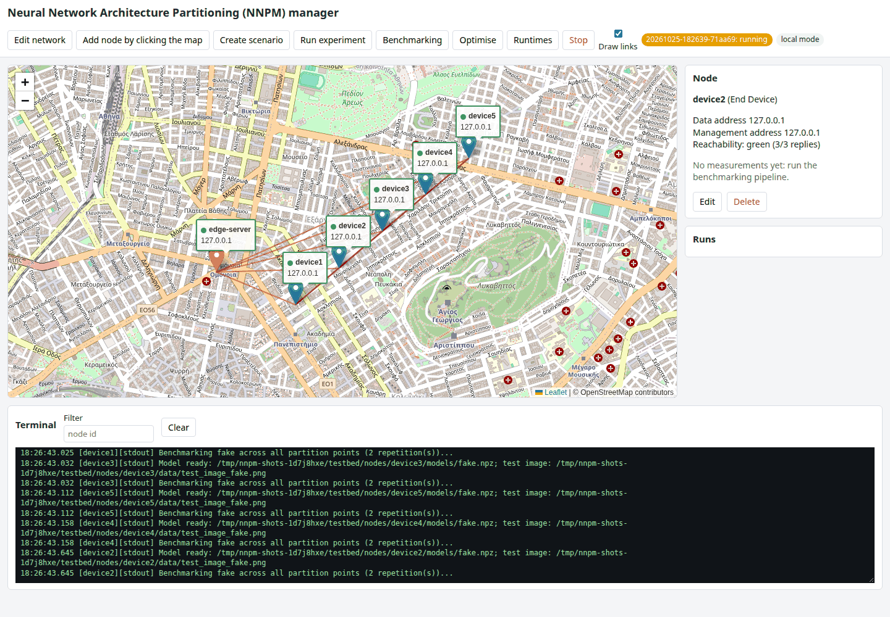

When the run finishes the indicator shows `completed` (or `aborted` with the reason), the Runs panel updates, and the node statistics measured by the run appear in the Node panel.

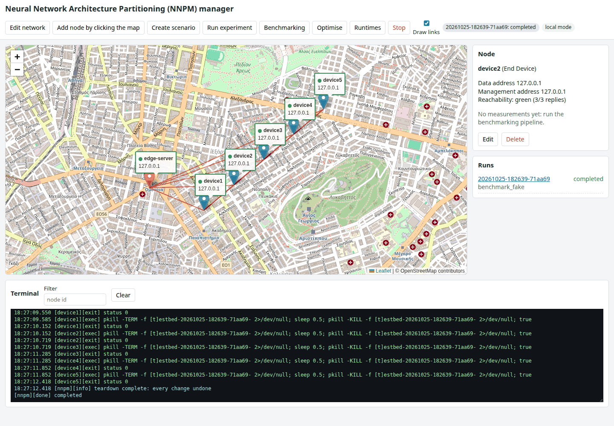

**Stop** aborts the running experiment at its next stage boundary. Every change recorded in the run journal is undone in reverse order (processes stopped, shaping cleared, frequencies restored, cgroups removed); the run directory keeps what was produced so far. A sweep stops as well: its queued runs are abandoned.

## 6. The run summary page

The run id in the Runs panel opens `/runs/<run id>`:

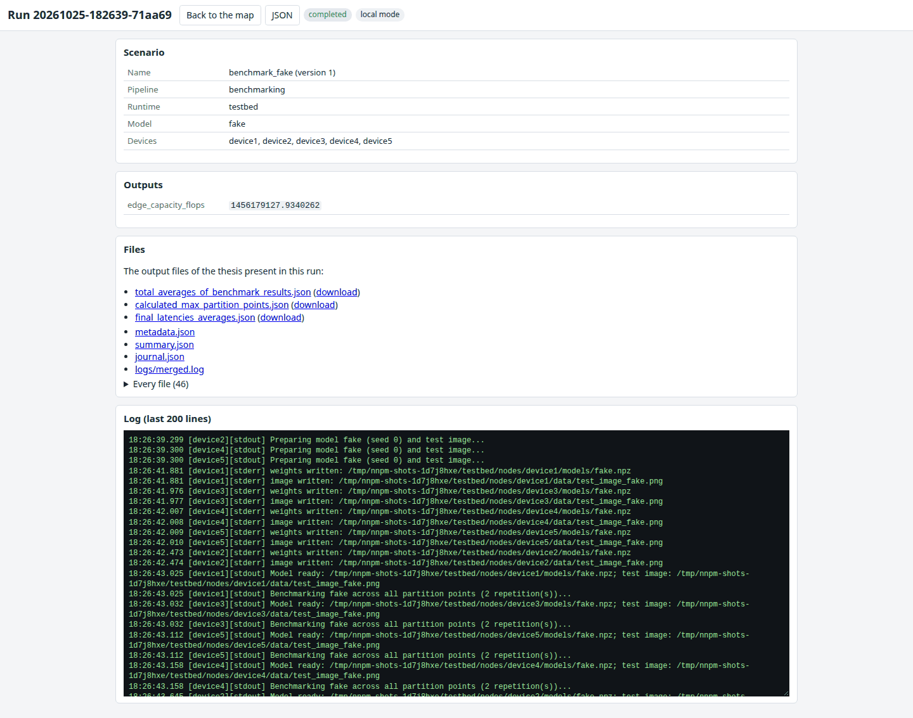

The page shows the scenario (name and version, pipeline, runtime, model, devices), the outputs (the edge server's measured capacity, the optimised partition vector and its objective), the three output files of the thesis with download links (`total_averages_of_benchmark_results.json`, `calculated_max_partition_points.json`, `final_latencies_averages.json`), the metadata, summary, journal and merged log, every other file of the run directory, and the last lines of the log. The JSON button returns the same as data (`GET /api/runs/<id>`).

## 7. Optimise

**Optimise** runs the partition optimiser on a finished profiling run without re-running anything on the devices: choose the run, the algorithm (greedy, exhaustive, trend-based, or a plug-in), the edge-server scheduling policy (RR or SJF), the objective (total delay or variance), the initial partition (`50%` of the model depth, an explicit list, or a `{node: s}` mapping), an optional maximum total delay per device and the transmission model (round-trip time only, or cut size over the measured rate plus latency).

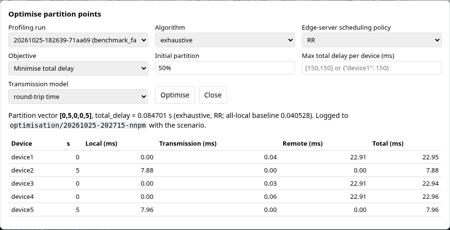

The result is the partition vector with the objective value and the all-local baseline, and a table per device (partition point, local, transmission, remote and total delay). It is written under `results/<run id>/optimisation/<timestamp>-nnpm/` with the scenario version, the hashes of its inputs and the search log.

## 8. Sweeps

A scenario with a sweep runs once per value. The Runs panel shows every run with its value; each run's summary page has the **Sweep** table: one row per value with the run id, its status and its main figure (the optimised total delay and vector for the testbed runtime, the per-mode totals for HeadSplit).

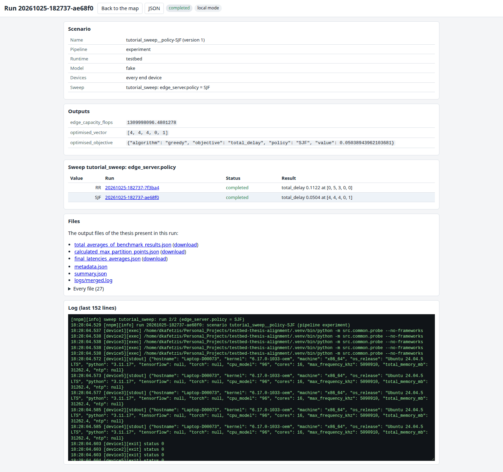

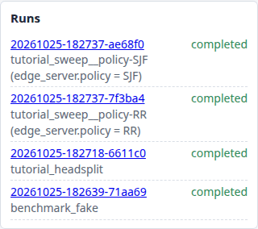

## 9. HeadSplit and other runtimes

Selecting the `headsplit` runtime in Create scenario adds the HeadSplit block, rendered from the runtime's own schema: the controller (a device), the workers (check boxes), the Hugging Face model, tokens, prompt length, mode (`headsplit`, `head_only`, `layer_based`, `all`), the speculation parameters and the time-out. The per-node shaping, load and heterogeneity blocks stay available, since the Chapter 6 studies combine them with HeadSplit.

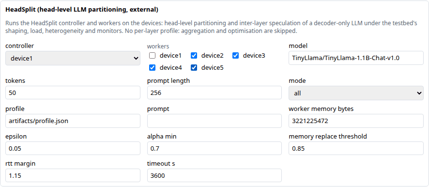

Before the first HeadSplit run, the devices need the runtime, its speculation profile and the checkpoint. The **Runtimes** dialog shows whether they have them and prepares them:

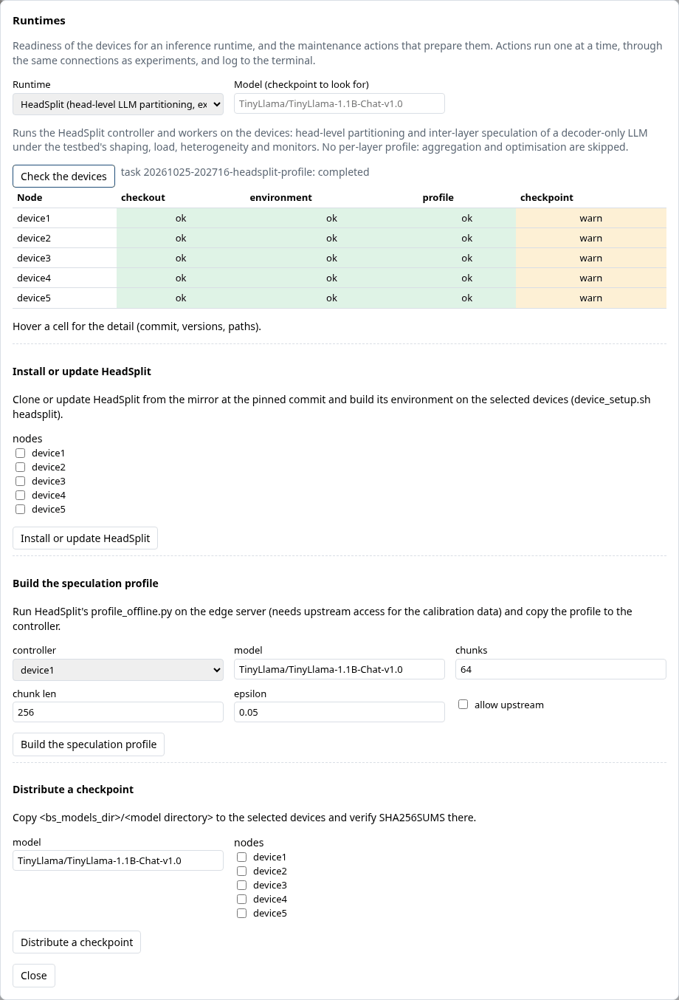

- **Check the devices** runs the runtime's readiness checks on every node through the same connections as experiments: for HeadSplit the checkout and its commit against `headsplit_commit`, the environment (`torch` and `transformers` import from HeadSplit's own virtual environment), the speculation profile on the controller, and the checkpoint in the devices' models directory (the model field changes which checkpoint is looked for). Green, amber, red; hover a cell for the detail.
- **Install or update HeadSplit** clones or updates the runtime from the mirror at the pinned commit and builds its environment on the selected devices.
- **Build the speculation profile** runs HeadSplit's `profile_offline.py` on the edge server (tick `allow_upstream`: the calibration data is downloaded) and copies the profile to the controller.
- **Distribute a checkpoint** copies `bs_models_dir/<model directory>` to the selected devices and verifies the checksums there (the model catalogue, `python -m src.models.weights fetch tinyllama --allow-upstream`, puts the checkpoint in `bs_models_dir` first).

Actions run as **tasks**: one at a time, never while an experiment runs; their log goes to the terminal tagged `[task]`, and Stop ends a running task after its current step.

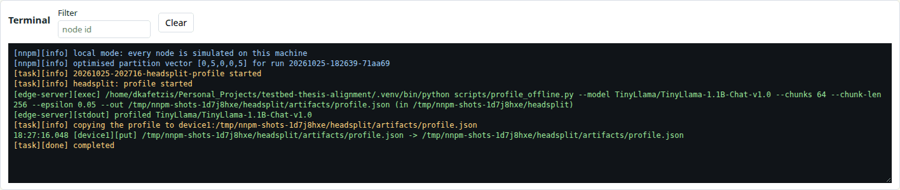

The summary page of a HeadSplit run has the **HeadSplit results** table: per mode the total, prefill and decode times, the payload, the speculation acceptance, the re-placements and the speed-up over layer-based partitioning, from the controller's JSON results (HeadSplit v0.1.0 and later) or its summary lines.

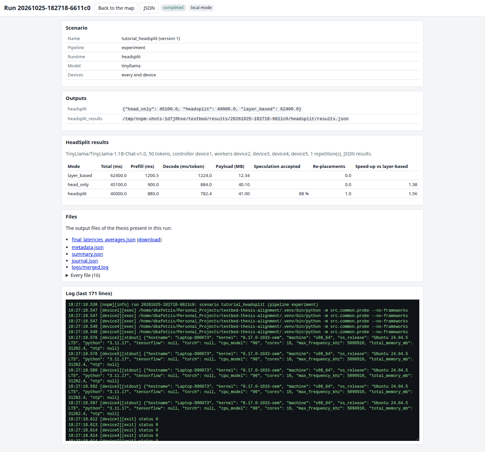

Any other runtime registered through the plug-in interface ([adding_a_runtime.md](adding_a_runtime.md)) appears in the same two drop-downs with its own block, checks and actions.

## 10. Local mode as a rehearsal

Everything above works in local mode: the fake model profiles in milliseconds, shaping and load run in dry-run mode, the HeadSplit checks and actions run against the directory named by `headsplit_dir` on this machine (the install action prints the plan it would run). Rehearse a scenario in local mode, then run the saved version on the hardware: the scenario file is the same.

## 11. Scripting NNPM

Every dialog is backed by an HTTP interface, so a shell script or a notebook can do what the dialogs do ([nnpm_user_guide.md](nnpm_user_guide.md) lists every route):

```bash
BASE=http://127.0.0.1:8001

# Save a scenario version and start it.
curl -s -X POST $BASE/api/scenarios -H 'Content-Type: application/json' \
    -d @examples/scenarios/baseline.yaml.json      # a scenario as JSON
curl -s -X POST $BASE/api/runs -H 'Content-Type: application/json' \
    -d '{"name": "baseline", "version": 1}'
# Follow the log (server-sent events) and read the result.
curl -sN $BASE/events/runs/<run id>
curl -s $BASE/api/runs/<run id> | python -m json.tool
# Readiness of the devices for HeadSplit, then an action.
curl -s "$BASE/api/runtimes/headsplit/status?model=TinyLlama/TinyLlama-1.1B-Chat-v1.0"
curl -s -X POST $BASE/api/runtimes/headsplit/actions/checkpoint \
    -H 'Content-Type: application/json' -d '{"nodes": ["device1", "device2"]}'
```

The command-line scripts (`scripts/base_station/run_experiment.sh`, `run_full_benchmarking.sh`, `clean_devices.sh`) use the same scenario files and write the same run directories, so runs started from either side appear in the Runs panel.
